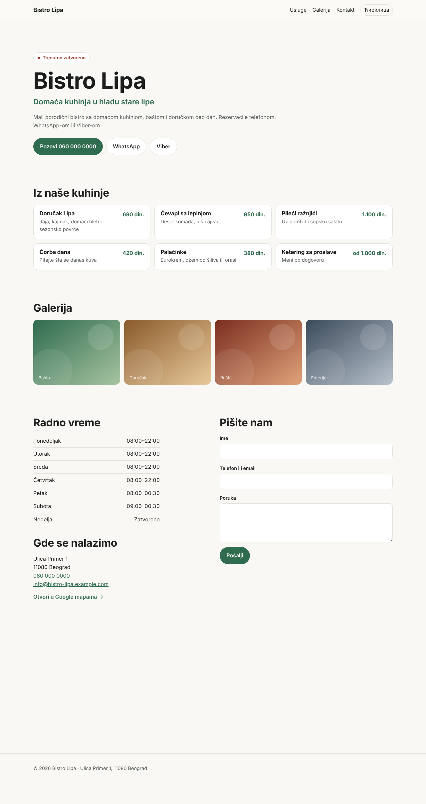
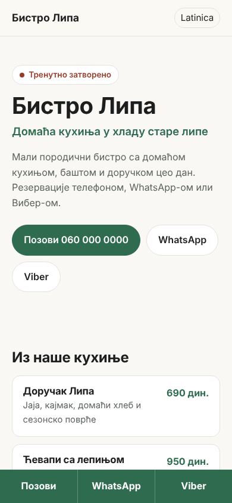

# Balkan Business Starter

A fast, static website starter for local businesses in Serbia and the Balkans —
cafés, restaurants, salons, workshops, clinics — built with Next.js and TypeScript.

Edit **one file** (`site.config.ts`), run `npm run build`, upload the `out/` folder anywhere.

| Desktop (Latin) | Mobile (Cyrillic) |
| --- | --- |
|  |  |

## Why this exists

Small businesses in the region are poorly served by English-first templates. They need things
that generic themes don't do:

- **Latin and Cyrillic.** Serbian is written in both scripts. Write content once in Latin and
  the starter generates a full Cyrillic version at `/cir/`, with correct `lang` and `hreflang`
  tags so Google indexes both. The transliterator handles digraphs (`lj`, `nj`, `dž`) and the
  words where they are *not* digraphs (`konjugacija`, `nadživeti`), and leaves brand names,
  emails and URLs alone.
- **The contact channels people actually use:** one-tap call, WhatsApp and **Viber**, plus a
  sticky call bar on phones.
- **Local SEO by default:** schema.org `LocalBusiness` JSON-LD with address, geo and opening
  hours, sitemap with language alternates, and a configurable local keyword ("restoran Zemun").
- **Opening hours that work like real ones:** a live "Open now" badge in Belgrade time,
  including places that close after midnight.
- **Prices in dinars,** formatted the local way (`1.100 din.`).
- **Static export:** no server and no database. Host it on Vercel, Netlify, GitHub Pages or plain
  cPanel shared hosting, which is what most local businesses already pay for.

## Quick start

```bash
npm install
npm run dev        # http://localhost:3000 and http://localhost:3000/cir
```

1. Edit `site.config.ts` (name, phone, address, hours, services, colors).
2. Put photos in `public/gallery/` and list them in the config with alt text.
3. `npm run build`, then upload the `out/` folder.

The contact form needs no backend: by default it opens the visitor's email app. To receive
messages directly, set `contact.formEndpoint` to a Formspree/Basin URL or your own API.

## Transliteration library

`lib/translit.ts` is dependency-free and can be used on its own:

```ts
import { toCyrillic, toLatin } from "./lib/translit";

toCyrillic("Ražnjići i džem od šljiva"); // "Ражњићи и џем од шљива"
toLatin("ЉУБАВ");                         // "LJUBAV"
```

Know a word where `lj`, `nj` or `dž` should stay split? Add its stem to `DIGRAPH_EXCEPTIONS`
and a test case. PRs are welcome.

## Project structure

```
site.config.ts         all business data (the only file most users edit)
components/HomePage    the page, rendered once per script
lib/translit.ts        Serbian Latin <-> Cyrillic
lib/hours.ts           open-now logic and schema.org opening hours
lib/seo.ts             metadata, hreflang, LocalBusiness JSON-LD
tests/                 node:test, no extra dependencies (npm test)
```

## Roadmap

- [ ] Publish the transliterator as a standalone npm package
- [ ] Bosnian, Croatian and Montenegrin presets (labels, `hreflang`, currency)
- [ ] Optional English version
- [ ] More layouts: salon (booking), workshop (before/after gallery), clinic
- [ ] A Claude Code workflow for generating a full client site from a short brief

## Contributing

Issues and PRs are welcome, especially transliteration edge cases, accessibility fixes and
layouts for new business types. Run `npm test && npm run build` before opening a PR.

---

## Na srpskom

Brz, statičan šablon za sajtove lokalnih biznisa. Menjate samo `site.config.ts`, sadržaj pišete
latinicom, a ćirilična verzija se pravi automatski na `/cir/`. Uključeni su poziv, WhatsApp i
Viber, radno vreme sa oznakom „Otvoreno sada“, cene u dinarima i lokalni SEO. Radi na bilo kom
hostingu, pa i na običnom cPanel-u.

Made in Belgrade by [Kinoptix Media](https://github.com/KinoptixMedia). MIT licensed.
